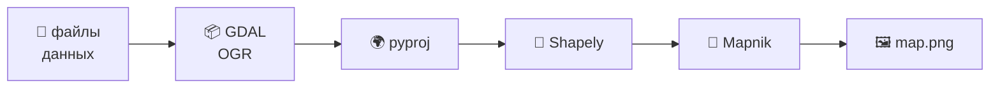

# 🗺️ Карта из чисел

## Как Python превращает данные в картинку

<div class="mt-10 text-xl opacity-80">
Глава 03 · растр и вектор · GDAL/OGR · pyproj · Shapely · Mapnik
</div>

<div class="mt-12 text-sm opacity-60">
Презентация для тех, кто ещё не знает, что такое ГИС
</div>

<!--
Задача занятия: показать, что «карта в компьютере» — это просто числа
и правила, как эти числа показать. Никакой магии.
-->

---
layout: center
class: text-center
---

# Компьютер не понимает «у школы» 🙂

<div class="mt-8 grid grid-cols-2 gap-8 text-left text-lg">

<div class="p-6 rounded-xl bg-red-50">

**Ты:** «Я у школы»

**Компьютер:** 🤖 «Это где?»

</div>

<div class="p-6 rounded-xl bg-green-50">

**Ты:** «55.75, 37.61»

**Компьютер:** ✅ «Понял, это Москва»

</div>

</div>

<div class="mt-10 text-xl">
Любая карта в компьютере — это <b>числа</b> и <b>правила</b>, как их показать.
</div>

<!--
Спросить детей: как бы они объяснили роботу, где стоит школа?
Подвести к мысли: нужны числа и договорённость, что они значат.
-->

---
layout: two-cols
---

# Два способа описать мир

<div class="mt-4 p-4 rounded-xl bg-blue-50">

### 🧩 Растр — «мозаика»

Мир нарезан на клетки. В каждой клетке — **одно число**:
цвет, высота, температура.

<svg viewBox="0 0 192 144" class="w-64 mx-auto mt-2 rounded-lg overflow-hidden">
  <rect width="192" height="144" fill="#64b5f6"/>
  <rect x="48" y="24" width="72" height="24" fill="#81c784"/>
  <rect x="24" y="48" width="48" height="24" fill="#81c784"/>
  <rect x="72" y="48" width="48" height="24" fill="#a1887f"/>
  <rect x="120" y="48" width="48" height="24" fill="#81c784"/>
  <rect x="24" y="72" width="144" height="24" fill="#81c784"/>
  <rect x="48" y="96" width="96" height="24" fill="#81c784"/>
  <rect x="96" y="120" width="48" height="24" fill="#ffd54f"/>
  <path d="M24 0V144M48 0V144M72 0V144M96 0V144M120 0V144M144 0V144M168 0V144M0 24H192M0 48H192M0 72H192M0 96H192M0 120H192"
        stroke="#ffffff" stroke-width="1" opacity="0.5"/>
</svg>

<p class="text-sm opacity-70 mt-1">Как экран телефона: близко видно клеточки.</p>

</div>

::right::

<div class="mt-4 p-4 rounded-xl bg-green-50">

### ✏️ Вектор — «конструктор»

Мир собран из **точек**, **линий** и **полигонов**.

<svg viewBox="0 0 220 150" class="w-full mt-1">
  <rect x="0" y="0" width="220" height="150" rx="10" fill="#e3f2fd"/>
  <path d="M30 110 L55 65 L105 50 L165 70 L195 110 L150 130 L70 130 Z"
        fill="#a5d6a7" stroke="#2e7d32" stroke-width="3"/>
  <line x1="55" y1="65" x2="150" y2="130" stroke="#1565c0"
        stroke-width="3" stroke-dasharray="6 4"/>
  <circle cx="55" cy="65" r="6" fill="#c62828"/>
  <circle cx="105" cy="50" r="6" fill="#c62828"/>
  <circle cx="165" cy="70" r="6" fill="#c62828"/>
  <circle cx="150" cy="130" r="6" fill="#c62828"/>
  <text x="78" y="98" style="font-size:11px" fill="#1b5e20">полигон</text>
  <text x="120" y="82" style="font-size:11px" fill="#0d47a1">линия</text>
  <text x="160" y="52" style="font-size:11px" fill="#b71c1c">точки</text>
</svg>

<p class="text-sm opacity-70 mt-1">Как рисунок по точкам: можно увеличивать без «квадратиков».</p>

</div>

<!--
Растр: «что лежит в каждой клетке». Вектор: «где какая фигура».
Оба способа нужны: фото — растр, дороги на карте — вектор.
-->

---
layout: two-cols
---

# Четыре помощника

<div class="text-sm space-y-3 mt-2">

<div class="p-3 rounded-xl bg-blue-50">
<b>📦 GDAL / OGR</b> — «переводчик файлов».<br/>
Читает и пишет растры (GDAL) и векторы (OGR).
</div>

<div class="p-3 rounded-xl bg-amber-50">
<b>🌍 pyproj</b> — «переводчик адресов».<br/>
Пересчитывает координаты из одной системы в другую.
</div>

<div class="p-3 rounded-xl bg-green-50">
<b>🔷 Shapely</b> — «конструктор фигур».<br/>
Точки, круги, полигоны и действия над ними.
</div>

<div class="p-3 rounded-xl bg-pink-50">
<b>🎨 Mapnik</b> — «художник».<br/>
Берёт данные и рисует из них картинку.
</div>

</div>

::right::

<div class="mt-4 text-center">



</div>

<div class="mt-6 p-4 rounded-xl bg-gray-50 text-sm">
<b>Важно:</b> каждый помощник умеет одно дело и делает его хорошо.
</div>

<!--
Не надо запоминать API. Надо запомнить роли: читать, пересчитывать,
строить фигуры, рисовать.
-->

---
layout: section
---

# 🧩 Часть 1. Растр

## Создаём «холст» из клеток

---
layout: two-cols
---

# `writeRaster.py`: холст 360 × 180

```python {all|5-9}
from osgeo import gdal

driver = gdal.GetDriverByName("GTiff")
dst = driver.Create(
    "Example Raster.tiff",  # имя файла
    360, 180, 1,            # ширина, высота, каналов
    gdal.GDT_Int16,         # целые числа
)
```

<div class="mt-4 p-4 rounded-xl bg-amber-50">
<b>360 × 180 = 64 800 клеток</b><br/>
Каждая клетка — <b>1 градус</b> по широте и долготе.<br/>
Вместе — вся планета 🌍
</div>

::right::

<div class="mt-8 text-center text-6xl">🖼️</div>

<div class="mt-3 text-center text-lg">
Примерно так выглядит сетка:
</div>

<svg viewBox="0 0 200 125" class="w-56 mx-auto mt-2">
  <defs>
    <pattern id="cells" width="25" height="25" patternUnits="userSpaceOnUse">
      <rect width="25" height="25" fill="#e3f2fd" stroke="#90caf9" stroke-width="1"/>
    </pattern>
  </defs>
  <rect width="200" height="125" fill="url(#cells)"/>
</svg>

<div class="mt-2 text-center text-sm opacity-70">
…только клеток не 40, а 64 800
</div>

<!--
Сравнение: лист в клеточку из тетради. Только большой.
Каждая клетка получит число — «высоту» от 1 до 100.
-->

---
layout: two-cols
---

# Приклеиваем «линейку» к картинке

Картинка из клеток ещё не знает, **где** она находится на Земле.

```python
spatialReference.SetWellKnownGeogCS("WGS84")
dst.SetProjection(spatialReference.ExportToWkt())

dst.SetGeoTransform([
    -180, 1.0, 0,   # левый верхний угол и ширина клетки
      90, 0, -1.0,  # верх и высота клетки (вниз!)
])
```

<div class="mt-4 p-4 rounded-xl bg-blue-50 text-sm">
<b>Геопривязка</b> — это ответ на два вопроса:<br/>
1️⃣ где левый верхний угол? &nbsp; 2️⃣ какого размера клетка?
</div>

::right::

<div class="mt-6 text-center">
<svg viewBox="0 0 320 200" class="w-full">
  <rect x="20" y="20" width="280" height="160" fill="#e3f2fd" stroke="#1565c0"/>
  <g stroke="#90caf9" stroke-width="1">
    <line x1="90" y1="20" x2="90" y2="180"/>
    <line x1="160" y1="20" x2="160" y2="180"/>
    <line x1="230" y1="20" x2="230" y2="180"/>
    <line x1="20" y1="60" x2="300" y2="60"/>
    <line x1="20" y1="100" x2="300" y2="100"/>
    <line x1="20" y1="140" x2="300" y2="140"/>
  </g>
  <circle cx="20" cy="20" r="5" fill="#c62828"/>
  <text x="26" y="16" style="font-size:11px" fill="#b71c1c">(-180, 90)</text>
  <text x="240" y="196" style="font-size:11px" fill="#0d47a1">1 клетка = 1°</text>
</svg>
</div>

<div class="mt-2 text-center text-sm opacity-70">
Без линейки это просто красивая картинка.<br/>
С линейкой — карта.
</div>

<!--
Аналогия: фотография без подписи и фотография с адресом.
Геопривязка превращает «просто пиксели» в «место на Земле».
-->

---
layout: two-cols
---

# Записываем числа

```python
for row in range(180):
    scanline = struct.pack(fmt, *values[row])
    band.WriteRaster(0, row, 360, 1, scanline)
```

<div class="mt-4 p-4 rounded-xl bg-green-50 text-sm">
Одна строка кода = <b>один ряд клеток</b>.<br/>
180 рядов — как 180 строчек в книге.<br/>
Пишем сверху вниз, слева направо.
</div>

::right::

```python
# То же самое, но короче:
# array = numpy.array(values, dtype=numpy.int16)
# band.WriteArray(array)
```

<div class="mt-4 p-4 rounded-xl bg-amber-50 text-sm">
<b>Два способа:</b><br/>
🐢 по строчке — «писать буквы от руки»;<br/>
🚀 массивом — «отправить готовую фотографию».
</div>

<div class="mt-4 text-sm opacity-70">
Результат одинаковый: файл `Example Raster.tiff`.
</div>

<!--
struct — это упаковка чисел в байты. Не надо пугаться: это просто
«перевод чисел в формат, который понимает файл».
-->

---
layout: two-cols
---

# `readRaster.py`: читаем обратно

```python
srcFile = gdal.Open("Example Raster.tiff")
band = srcFile.GetRasterBand(1)

for row in range(band.YSize):
    scanline = band.ReadRaster(
        0, row, band.XSize, 1,
        band.XSize, 1,
        band.DataType)
    row_data = struct.unpack(fmt, scanline)
    print(row_data)
```

<div class="mt-4 p-4 rounded-xl bg-green-50 text-sm">
Сначала читаем <b>по строчке</b> — как книгу.<br/>
Потом можно взять <b>всю таблицу сразу</b> через NumPy.
</div>

::right::

<div class="p-4 rounded-xl bg-red-50 text-sm">

### ⚠️ В конце скрипта — ошибка

```python
values = band.ReadAsArray()
for row in range(band.XSize):  # 360
    print(values[row])
```

Рядов всего **180**, а цикл просит **360**:

```
IndexError: index 180 is out of bounds
```

</div>

<div class="mt-4 text-sm">
Это <b>ошибка в учебном коде</b>, а не поломка Python.<br/>
Данные до этого места прочитаны правильно ✅
</div>

<!--
Показать на экране: сначала идёт длинный вывод, потом traceback.
Важно: ошибка не мешает понять, как устроено чтение.
-->

---
layout: section
---

# ✏️ Часть 2. Вектор

## Сто наклеек с именами

---
layout: two-cols
---

# `writeVector.py`: 100 точек

```python {all|4-6|8-9}
driver = ogr.GetDriverByName("ESRI Shapefile")
datasource = driver.CreateDataSource(
    "test-shapefile/shapefile.shp")
layer = datasource.CreateLayer("layer", spatialReference)

field = ogr.FieldDefn("ID", ogr.OFTInteger)
field.SetWidth(4)
layer.CreateField(field)

field = ogr.FieldDefn("NAME", ogr.OFTString)
field.SetWidth(20)
layer.CreateField(field)
```

::right::

<div class="p-4 rounded-xl bg-amber-50 text-sm">

### Что внутри?

| Поле | Тип | Пример |
| --- | --- | --- |
| `ID` | целое | 1000 |
| `NAME` | строка | point-0 |

</div>

<div class="mt-4 p-4 rounded-xl bg-blue-50 text-sm">
Координаты <b>случайные</b>: широта от −90 до +90,<br/>
долгота от −180 до +180.<br/>
То есть точки разбросаны по всей планете 🌍
</div>

<div class="mt-4 text-sm">
Каждая точка — как наклейка:<br/>
<b>где</b> (координаты) + <b>подпись</b> (ID и имя).
</div>

<!--
Спросить: что получится, если запустить скрипт дважды?
Правильный ответ: папка test-shapefile удалится и создастся заново.
-->

---
layout: two-cols
---

# `readVector.py`: читаем наклейки

```python
shapefile = ogr.Open("test-shapefile/shapefile.shp")
layer = shapefile.GetLayer(0)

for i in range(layer.GetFeatureCount()):
    feature = layer.GetFeature(i)
    name = feature.GetField("NAME")
    geometry = feature.GetGeometryRef()
    print(i, name, geometry.GetX(), geometry.GetY())
```

<div class="mt-4 p-4 rounded-xl bg-green-50 text-sm">
Слой → объекты → поля и геометрия.<br/>
Как коробка с наклейками: достаём по одной.
</div>

::right::

```
0  point-0  105.35  -39.71
1  point-1   ...
...
99 point-99 -42.53   29.98
```

<div class="mt-4 p-4 rounded-xl bg-red-50 text-sm">
<b>Сначала</b> запусти <code>writeVector.py</code>,<br/>
иначе файла нет и программа упадёт.
</div>

<div class="mt-4 text-sm opacity-70">
Ошибка выглядит как <code>'NoneType' object has no attribute
'GetLayer'</code> — это «файл не найден».
</div>

<!--
Показать связку: writeVector создаёт данные, readVector их читает.
Порядок важен.
-->

---
layout: section
---

# 🌍 Часть 3. Координаты

## Один город — два адреса

---
layout: two-cols
---

# `pyproj_example.py`: перевод адреса

<div class="text-sm">

Одна и та же точка записана **двумя способами**:

| Способ | Как выглядит |
| --- | --- |
| UTM, зона 11 | 565718.52, 3980998.92 (метры) |
| Широта/долгота | −116.27, 35.97 (градусы) |

</div>

```python
srcProj = pyproj.Proj(
    proj="utm", zone="11", ellps="clrk66")
dstProj = pyproj.Proj(
    proj="longlat", ellps="WGS84")
long, lat = pyproj.transform(
    srcProj, dstProj,
    565718.5235, 3980998.9244)
```

<div class="mt-3 p-3 rounded-xl bg-blue-50 text-sm">
Как адрес дома: «третий от угла» и «улица, дом 5» —<br/>
это одно место, но записано по-разному.
</div>

::right::

<div class="mt-10 text-center text-7xl">🧭</div>

<div class="mt-6 text-center text-lg">
<b>pyproj</b> переводит метры в градусы<br/>
и обратно — без похода в интернет.
</div>

<div class="mt-6 text-sm opacity-70 text-center">
В коде написано «зона 11»,<br/>
а в сообщении — «зона 17». Маленькая опечатка в книге 🙂
</div>

<!--
Не углубляться в датумы. Главное: координаты бывают в разных
«системах отсчёта», и их надо переводить.
-->

---
layout: two-cols
---

# Идём на 10 км по компасу

```python
angle = 315      # 315° = северо-восток
distance = 10000 # метров

geod = pyproj.Geod(ellps="WGS84")
long2, lat2, invAngle = geod.fwd(long, lat, angle, distance)
```

<div class="mt-4 p-4 rounded-xl bg-green-50 text-sm">

Было: **−116.2711, 35.9730**<br/>
Стало: **36.0367, −116.3496**

</div>

<div class="mt-2 text-sm">
`Geod` умеет считать по <b>шарику Земли</b>,<br/>
а не по плоскому листу бумаги.
</div>

::right::

<div class="mt-4 text-center">
<svg viewBox="0 0 260 220" class="w-full">
  <rect x="0" y="0" width="260" height="220" rx="12" fill="#e8f5e9"/>
  <circle cx="70" cy="160" r="7" fill="#2e7d32"/>
  <circle cx="190" cy="60" r="7" fill="#c62828"/>
  <line x1="70" y1="160" x2="190" y2="60" stroke="#1565c0"
        stroke-width="3" stroke-dasharray="8 5"/>
  <text x="30" y="190" style="font-size:12px" fill="#1b5e20">старт</text>
  <text x="175" y="45" style="font-size:12px" fill="#b71c1c">финиш</text>
  <text x="100" y="120" style="font-size:12px" fill="#0d47a1">10 км</text>
  <text x="120" y="200" style="font-size:12px" fill="#0d47a1">↖ 315°</text>
</svg>
</div>

<div class="text-center text-sm opacity-70">
Компас: 0° — север, 90° — восток,<br/>
180° — юг, 270° — запад, 315° — северо-запад.
</div>

<div class="mt-2 text-center text-xs opacity-60">
В книге 315° назван «северо-востоком» —<br/>
на самом деле это северо-запад 🙂
</div>

<!--
Проверить вместе: 315° — это северо-запад, а в книге написано
«northeast». Ещё одна неточность текста, код работает.
-->

---
layout: section
---

# 🔷 Часть 4. Фигуры

## Shapely — конструктор

---
layout: two-cols
---

# `shapely_example.py`: круг и квадрат

```python
import shapely.geometry

pt = shapely.geometry.Point(0, 0)
circle = pt.buffer(1.0)

square = shapely.geometry.Polygon([
    (0, 0), (1, 0), (1, 1), (0, 1), (0, 0),
])
```

<div class="mt-4 p-4 rounded-xl bg-green-50 text-sm">
<b>Point</b> — точка. <b>buffer(1.0)</b> — «надуть» её в круг<br/>
радиусом 1. <b>Polygon</b> — замкнутая ломаная.
</div>

::right::

<div class="mt-2 text-center">
<svg viewBox="0 0 240 200" class="w-full">
  <rect x="0" y="0" width="240" height="200" fill="#fafafa"/>
  <circle cx="140" cy="100" r="70" fill="#bbdefb" stroke="#1565c0" stroke-width="2"/>
  <rect x="70" y="30" width="70" height="70" fill="#c8e6c9" stroke="#2e7d32"
        stroke-width="2" opacity="0.85"/>
  <circle cx="140" cy="100" r="4" fill="#0d47a1"/>
  <text x="146" y="104" style="font-size:11px" fill="#0d47a1">(0, 0)</text>
</svg>
</div>

<div class="text-center text-sm opacity-70">
Квадрат стоит в углу круга —<br/>
они пересекаются.
</div>

<!--
Shapely не рисует. Он считает форму: где границы, что внутри,
пересекаются ли фигуры.
-->

---
layout: two-cols
---

# Что общего у круга и квадрата?

```python
intersect = circle.intersection(square)

for x, y in intersect.exterior.coords:
    print(x, y)

print(shapely.wkt.dumps(intersect))
```

<div class="mt-4 p-4 rounded-xl bg-amber-50 text-sm">
<b>Пересечение</b> — общая часть двух фигур.<br/>
Как вырезать печенье формочкой: остаётся только то,<br/>
что попало внутрь.
</div>

::right::

<div class="text-center">
<svg viewBox="0 0 240 170" class="w-full">
  <rect x="0" y="0" width="240" height="170" fill="#fafafa"/>
  <circle cx="140" cy="85" r="60" fill="#e3f2fd" stroke="#90caf9" stroke-dasharray="5 4"/>
  <rect x="80" y="25" width="60" height="60" fill="#e8f5e9" stroke="#a5d6a7" stroke-dasharray="5 4"/>
  <path d="M80 85 A60 60 0 0 1 140 25 L140 85 Z" fill="#ffcc80" stroke="#ef6c00" stroke-width="2"/>
  <text x="120" y="150" style="font-size:11px" fill="#e65100">общая часть</text>
</svg>
</div>

<div class="mt-4 p-3 rounded-xl bg-blue-50 text-sm">
<b>WKT</b> — фигура, записанная буквами:
<code>POLYGON ((...))</code>.<br/>
Так её можно сохранить в файл или отправить другому.
</div>

<!--
Показать вывод: длинный POLYGON ((...)).
Это «текстовый портрет» фигуры.
-->

---
layout: section
---

# 🎨 Часть 5. Картинка

## Mapnik раскрашивает карту

---
layout: two-cols
---

# `mapnik_example.py`: раскраска по правилам

```python
symbolizer = mapnik.PolygonSymbolizer(
    mapnik.Color("darkgreen"))

map = mapnik.Map(800, 400)
map.background = mapnik.Color("steelblue")
map.zoom_all()
mapnik.render_to_file(map, "map.png", "png")
```

<div class="mt-4 p-4 rounded-xl bg-green-50 text-sm">
<b>Правило:</b> «все страны — тёмно-зелёные».<br/>
<b>Фон:</b> «море — синее».<br/>
<b>Размер:</b> 800 × 400 точек.
</div>

::right::

<div class="text-center text-6xl mt-6">🎨</div>

<div class="mt-4 p-4 rounded-xl bg-blue-50 text-sm">
Как раскраска по номерам:<br/>
сначала контуры, потом цвет внутри.
</div>

<div class="mt-4 p-3 rounded-xl bg-amber-50 text-sm">
Нужен файл <code>TM_WORLD_BORDERS-0.3.shp</code> —<br/>
границы стран мира.
</div>

<!--
Здесь же сказать: mapnik в этом окружении не установлен и API старый,
поэтому слайд — «как это должно работать», а не «запустите сейчас».
-->

---
class: text-sm
---

# Что получилось

| Файл | Кто создал | Что внутри |
| --- | --- | --- |
| `Example Raster.tiff` | `writeRaster.py` | сетка 360 × 180 чисел |
| `test-shapefile/` | `writeVector.py` | 100 точек с ID и NAME |
| `map.png` | `mapnik_example.py` | карта стран |

<div class="mt-8 grid grid-cols-4 gap-3 text-center text-xs">

<div class="p-3 rounded-xl bg-blue-50">
<div class="text-2xl">📄</div>
<b>GDAL / OGR</b><br/>читает данные
</div>

<div class="p-3 rounded-xl bg-amber-50">
<div class="text-2xl">🌍</div>
<b>pyproj</b><br/>пересчитывает координаты
</div>

<div class="p-3 rounded-xl bg-green-50">
<div class="text-2xl">🔷</div>
<b>Shapely</b><br/>строит фигуры
</div>

<div class="p-3 rounded-xl bg-pink-50">
<div class="text-2xl">🎨</div>
<b>Mapnik</b><br/>рисует карту
</div>

</div>

<div class="mt-6 text-center text-base">
Один и тот же набор чисел можно показать таблицей, картинкой или картой.
</div>

<!--
Главная мысль: данные отдельно, картинка отдельно.
Поэтому одну и ту же карту можно перекрасить, не меняя данные.
-->

---
layout: two-cols
---

# Попробуй сам

```bash
cd "Chapter 03"

python3 writeRaster.py    # создаст Example Raster.tiff
python3 readRaster.py     # прочитает его

python3 writeVector.py    # создаст test-shapefile/
python3 readVector.py     # прочитает точки

python3 pyproj_example.py
python3 shapely_example.py
```

::right::

<div class="mt-2 p-4 rounded-xl bg-amber-50 text-sm">

**Порядок важен!**

<code>readRaster</code> и <code>readVector</code> не создают данные —<br/>
они читают то, что сделали соседние скрипты.

</div>

<div class="mt-3 p-4 rounded-xl bg-blue-50 text-sm">
<b>Показать презентацию:</b>

```bash
npx @slidev/cli slides.md
```

или в проекте `Geo_development`:

```bash
npm run dev
```

</div>

<!--
Если данных нет — сначала write-скрипты.
Для mapnik нужен шейп-файл из папки GDAL.
-->

---
layout: two-cols
---

# Осторожно: три ловушки

<div class="space-y-3 mt-2 text-sm">

<div class="p-3 rounded-xl bg-red-50">
<b>1. `readRaster.py` падает в конце</b><br/>
<code>IndexError: index 180 … size 180</code> — ошибка в учебном коде.
</div>

<div class="p-3 rounded-xl bg-red-50">
<b>2. `mapnik` не установлен</b><br/>
И код написан для старой версии Mapnik 2.
</div>

<div class="p-3 rounded-xl bg-red-50">
<b>3. `writeVector.py` удаляет папку</b><br/>
<code>test-shapefile/</code> стирается и создаётся заново.
</div>

</div>

::right::

<div class="mt-4 p-4 rounded-xl bg-amber-50 text-sm">

**Если файл не найден**

Программа скажет что-то вроде:

<code>'NoneType' object has no attribute 'GetLayer'</code>

Это значит: **нет входных данных**,<br/>
а не «сломался Python».

</div>

<div class="mt-4 text-sm">
Все скрипты ищут файлы <b>рядом с собой</b>,<br/>
поэтому запускать их нужно из их папки.
</div>

<!--
Эти ловушки проверены запуском. Не надо их «чинить» без просьбы:
это архив учебных материалов.
-->

---
layout: center
class: text-center
---

# Что запомнить

<div class="mt-6 grid grid-cols-2 gap-4 text-left text-base">

<div class="p-4 rounded-xl bg-blue-50">🧩 <b>Растр</b> — сетка клеток с числами</div>
<div class="p-4 rounded-xl bg-green-50">✏️ <b>Вектор</b> — точки, линии, полигоны</div>
<div class="p-4 rounded-xl bg-amber-50">🌍 <b>pyproj</b> — перевод координат</div>
<div class="p-4 rounded-xl bg-pink-50">🔷 <b>Shapely</b> — фигуры и их пересечения</div>
<div class="p-4 rounded-xl bg-purple-50">🎨 <b>Mapnik</b> — данные превращает в картинку</div>
<div class="p-4 rounded-xl bg-gray-100">📦 <b>GDAL/OGR</b> — читает и пишет файлы</div>

</div>

<div class="mt-10 text-xl">
Карта в компьютере — это <b>числа</b>, <b>фигуры</b> и <b>правила</b>.<br/>
Всё остальное — удобные инструменты вокруг них.
</div>

<div class="mt-8 text-lg opacity-70">
А теперь вопрос: чем нарисовать карту твоего двора — растром или вектором? 🤔
</div>

<!--
Финальный вопрос — на обсуждение. Хороший ответ: и тем и другим:
растр — спутниковый снимок, вектор — дорожки и дома.
-->
